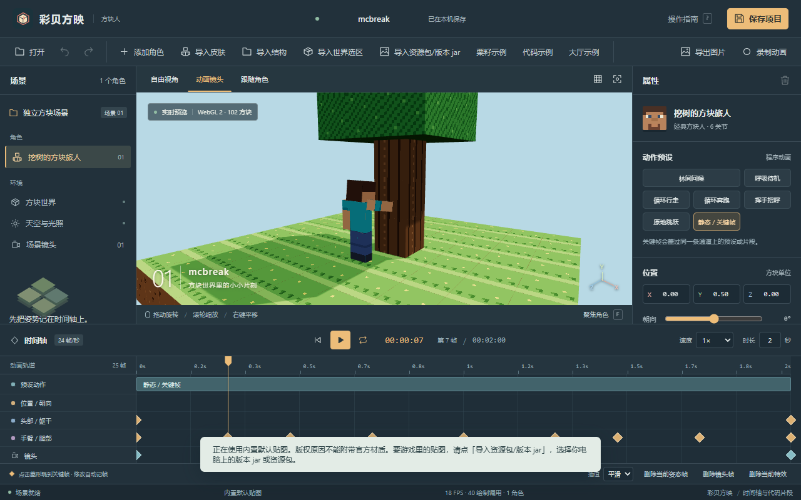

# minecraft-animation

  <strong>彩贝方映 · 用代码编排，在网页里精修，把方块世界变成动画。</strong>

  
  
  
  

  <a href="https://www.npmjs.com/package/minecraft-animation">npm</a> ·
  <a href="https://github.com/CyanBukkit/minecraft-animation">GitHub</a> ·
  <a href="docs/skills/minecraft-animation/SKILL.md">AI 技能</a> ·
  <a href="docs/minecraft-animation.md">使用指南</a> ·
  <a href="https://github.com/CyanBukkit/minecraft-animation/issues">反馈问题</a>

**minecraft-animation** 是基于 Three.js 的 Minecraft 风格网页动画工作室，提供 Node.js CLI、可编程场景、可编辑时间轴和 WebM 渲染。AI 读取技能后编写场景代码；你也可以在浏览器里调整角色、关键帧与镜头。**无需安装桌面 Blender。**

> 实际工作室截图，使用项目原创默认贴图。内置挖树模板演示挥拳击打树干，不包含方块破坏或倒树。

## 为什么用它

| 能力 | 你能做什么 |
| --- | --- |
| AI 可编程 | 一句话说明故事，由 AI 编写 `scene.mjs`，控制人物、动作、方块和镜头 |
| 网页时间轴 | 拖动时间、调整关节、记录姿势，代码生成的关键帧仍可手动编辑 |
| 场景 SDK | 使用 `Composition`、`Actor`、`Sequence`、`Camera` 和 `World` 编排作品 |
| 肢体动画 | 经典直肢 / 弯曲肘膝切换，新增下蹲、坐姿、出拳、踢腿，支持独立关键帧 |
| 表情与特写 | 原皮肤脸 / 动画脸切换，眨眼、注视、嘴眉控制，镜头跟随面部或眼睛 |
| 肢体碰撞检查 | 按帧、子帧及关键帧检查经典手臂或弯曲四肢，报告时间与部位，失败时阻止 CLI 出片 |
| 离线视频 | Chromium 按时间戳采样、编码无声 WebM，附海报及渲染回执 |
| 资源导入 | 网页支持经典宽臂皮肤、资源包、地图选区和部分 Blender / glTF 动画数据，默认 / 导入贴图可切换 |

> 弯曲肢体、表情和跟随特写已在仓库源码实现；npm 现有 `0.1.0` 尚不包含这些新增功能，需下一次成功发布后才会提供。当前可从源码运行。

## 快速开始

需要 **Node.js 22+**；网页需要支持 WebGL 2 的现代浏览器，CLI 渲染需要 Playwright Chromium。

~~~bash
npm install minecraft-animation
npx playwright install chromium
npx minecraft-animation create mcbreak --prompt "人物挖掘树"
npx minecraft-animation check mcbreak
npx minecraft-animation preview mcbreak
~~~

打开终端打印的网页地址（默认 `http://127.0.0.1:47321/?project=1`）。预览服务会持续运行，按 `Ctrl+C` 停止，或另开终端出片：

~~~bash
npx minecraft-animation render mcbreak --output mcbreak-render
~~~

输出目录必须不存在，避免覆盖作品：

~~~text
mcbreak/
  scene.mjs                     可编辑的代码入口
  project.json                  网页工作室项目
  docs/brief.json               原始创作要求
  docs/skills/minecraft-animation/SKILL.md
mcbreak-render/
  movie.webm                    无声视频
  poster.png                    首帧海报
  receipt.json                  帧数、尺寸、时长与解码校验
~~~

> `--prompt` 只保存创作要求，CLI 不内置语言模型。默认只提供 `mine-tree` 模板，其他故事由调用技能的 AI 或你自己编写。

## 交给 AI 来编排

**[下载封装技能](https://github.com/CyanBukkit/minecraft-animation/raw/refs/heads/main/docs/downloads/minecraft-animation.skill)** · **[查看 SKILL.md](docs/skills/minecraft-animation/SKILL.md)**

技能包是 ZIP 格式的 `.skill` 文件，内部为 `minecraft-animation/SKILL.md`。支持技能上传的工具可导入；其他工具可解压，将该目录放到工具自己的技能目录，或直接把 `SKILL.md` 提供给 AI。npm 安装不会更改全局 AI 配置。

也可直接读取发布包中的技能：

~~~bash
npx minecraft-animation skill
~~~

对 AI 说：

> 使用 minecraft-animation 技能，制作一段人物挖树的 4 秒动画，设置镜头和动作。先检查手臂碰撞，再预览并输出视频。

工作流：**创作要求 → scene.mjs → build → check → preview → render**。

## 用代码修改动画

编辑生成项目的 `scene.mjs`。CLI 会注入 SDK，无须在场景目录另装依赖：

~~~js
export default function scene({ createMineTreeProject }) {
  const project = createMineTreeProject({
    name: '林间挖树',
    duration: 4,
    fps: 24,
  });
  project.cameraTracks.fov = [
    { time: 0, value: 43, easing: 'smooth' },
    { time: 4, value: 36, easing: 'smooth' },
  ];
  return project;
}
~~~

~~~bash
npx minecraft-animation build mcbreak
npx minecraft-animation check mcbreak
~~~

场景默认导出可返回项目对象或 `Composition`。坐标 Y 向上、角色正脸朝 +Z、1 单位为一格，关节角度使用弧度。**只执行可信的场景代码，它拥有普通 Node.js 脚本权限。**

网页改动可保存为项目 JSON，再传给 `check` / `render`；不会反向改写 `scene.mjs`。修改代码后要重启预览服务。

## CLI 速查

| 命令 | 用途 |
| --- | --- |
| `create <目录> [--template mine-tree] [--prompt 描述]` | 创建项目，不覆盖已有目录 |
| `build <目录或 scene.mjs>` | 从代码更新 `project.json` |
| `check <目录、scene.mjs 或 project.json>` | 输出 JSON 碰撞报告，失败退出码为 2 |
| `preview <项目> [--port 47321]` | 本机网页工作室 |
| `render <项目> --output <新目录>` | 渲染 WebM，默认 640×360 |
| `skill` | 输出 AI 技能全文 |

渲染可加 `--width 1280 --height 720`，或用 `--browser-executable "浏览器路径"` 指定 Chromium。源码仓库中可将 `npx minecraft-animation` 替换为 `node minecraft-animation`。

## 能力边界

- **不是完整 Blender**：不执行 Blender 的约束、IK 或完整工程。导入范围见 [Blender / 栗籽人模指南](docs/blender-chestnutmc.md)。
- **不是通用物理引擎**：碰撞报告覆盖经典手臂或弯曲四肢与身体、其他角色和显式方块，关节连接区的豁免范围见[使用指南](docs/minecraft-animation.md#边界与验证)；不覆盖透明皮肤外层、手持工具、glTF 道具，也不证明任意连续时间都安全。
- **严格区分场景**：CLI 完整碰撞检查只支持 `World.empty(blocks)`。营地、高度图和导入道具会报告 `unsupported` 并阻止 CLI 渲染；网页可编辑这些场景，不代表其碰撞已通过。
- **当前视频为无声 WebM**：没有内建 MP4 转码、音轨、树块破坏或整树倒塌。
- **素材各自授权**：内置贴图为本项目原创小图，不含 Mojang 官方资源。个人皮肤、地图、版本 jar 与第三方模型请自行合法提供，不随开源包分发。

## 本地开发

~~~bash
git clone git@github.com:CyanBukkit/minecraft-animation.git
cd minecraft-animation
npm ci
npx playwright install chromium
npm test
npm run build
npm run test:web
npm run dev
~~~

源码开发服务器为 `http://127.0.0.1:47321`。需要重打技能包时执行 `npm run skill:pack`；验证 npm 安装包、CLI、碰撞拦截与实际渲染执行 `npm run test:package`（需先构建，且 Chromium 已安装）。

~~~text
.github/workflows/   CI 与 npm 可信发布
bin/                 命令行入口
src/caibei/           动画编排与导入 SDK
src/core/            项目、关键帧与人物尺寸
src/node/            项目加载、预览服务与离线出片
src/scene/           Three.js 场景与人物
public/              原创默认贴图与合成示例
docs/skills/         可分发 AI 技能
scripts/             录制、打包和验收工具
test/                Node.js 逻辑测试
~~~

## 自动发布与贡献

- **CI**：push / PR 执行逻辑测试、构建、网页回归、技能一致性检查与安装包出片验证。
- **npm 发布**：发布正式 GitHub Release 后，`publish.yml` 校验 tag 与 package 版本一致，验证通过后用 OIDC 上传 npm。
- **首次需绑定**：npm 账号中配置 Trusted Publisher 后才可自动上传，不需要长期 `NPM_TOKEN`。步骤见 [发布指南](docs/npm-publish.md)。

欢迎提交 Issue 和 PR。请附复现步骤，保持改动聚焦，并执行相关测试；不要提交个人地图、皮肤、官方材质、密钥或构建缓存。

## Contributors

| 贡献者 | 说明 |
| --- | --- |
| **SmallXY** · [2569224983@qq.com](mailto:2569224983@qq.com) | 项目作者与维护者 |
| [CyanBukkit](https://github.com/CyanBukkit) | 协作者 |
| [Codex](https://openai.com/codex/) | AI 辅助开发、文档与验证 |

## 许可与致谢

本项目代码与原创默认贴图采用 **[ISC License](docs/LICENSE.md)**。第三方依赖保留各自许可。感谢 [Three.js](https://threejs.org/)、[Vite](https://vite.dev/) 与 [Playwright](https://playwright.dev/) 提供底层能力；代码编排方式参考了 Remotion 的 Composition / Sequence 思路。

这是独立社区项目，与 Mojang、Microsoft 无隶属或背书关系。
